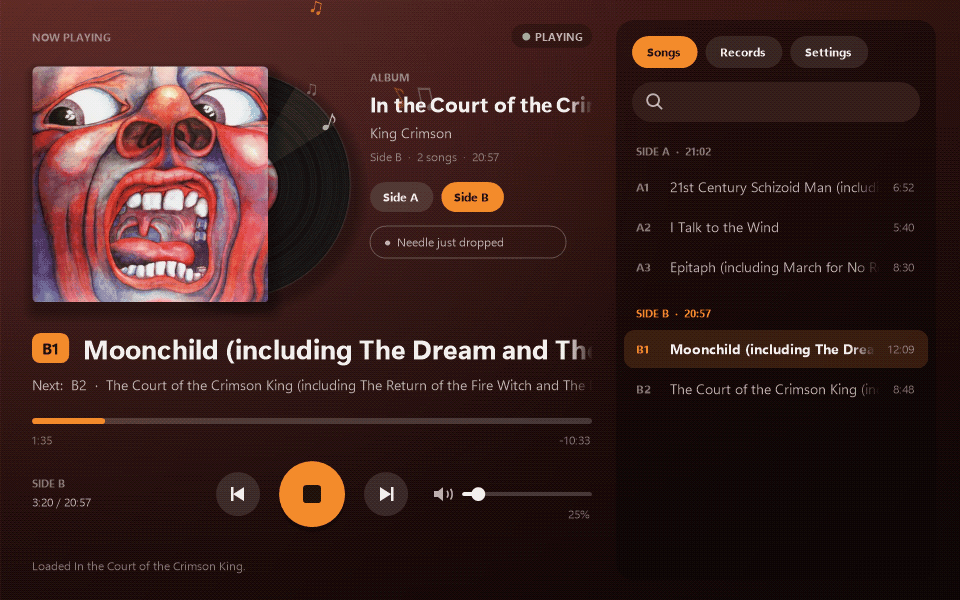

<h1 align="center">Turntable Listener</h1>

Your record player, on your PC. Hear a USB turntable through your speakers, with album art, song names, flip reminders, Discord status and scrobbling.

<a href="https://github.com/yveswaree/turntable-listener/releases/latest/download/TurntableListener.zip"><b>Download for Windows</b></a> &middot; <a href="https://yveswaree.github.io/turntable-listener/">Website</a> &middot; <a href="https://github.com/yveswaree/turntable-listener/issues">Report a problem</a>

## Features

- **Hear your turntable** through any speakers or headphones, with its own volume and level meter
- **Album cover and song names**: search an album once, and it follows along side by side
- **Flip reminders**: it hears the arm lift at the end of a side and tells you
- **Discord**: "Listening to" with the album art
- **Scrobbling** to Last.fm and ListenBrainz
- **Your record shelf**: every album you play, with play counts, or import your collection from Discogs
- **Stylus hours**: reminds you when the needle is due for replacing
- **Music visuals**: the record bounces, notes float, and the backdrop takes the album's colours

## Getting started

1. [Download the zip](https://github.com/yveswaree/turntable-listener/releases/latest/download/TurntableListener.zip) and unzip it anywhere.
2. Open **TurntableListener.exe**. If Windows says *"Windows protected your PC"*, click **More info** and then **Run anyway** (normal for new independent apps).
3. Follow the one-minute setup: pick your turntable and let it hear the silence.
4. Drop the needle.

**Requirements:** Windows 10 or 11 and a turntable that connects with USB.

## Privacy

Your audio never leaves your PC. Album searches go to MusicBrainz, and covers come from the Cover Art Archive. Discord, ListenBrainz and Last.fm only see what you're playing if you turn them on, Discogs is only contacted if you import from it, and a daily version check goes to GitHub. Settings, history and sign-ins are stored only on your PC. There's no tracking.

## Reporting a problem

[Open an issue](https://github.com/yveswaree/turntable-listener/issues) and mention your turntable model. If the app showed an error, attach `crash.log` (Settings → About → Open the data folder).

## License

Turntable Listener is free to use but not open source. See [EULA.txt](EULA.txt).

Album information from [MusicBrainz](https://musicbrainz.org), covers from the [Cover Art Archive](https://coverartarchive.org). Not affiliated with Sony, Audio-Technica, Discord, Last.fm or the MetaBrainz Foundation.

© 2026 yveswaree · Developed with coding and deployment assistance from Claude.
